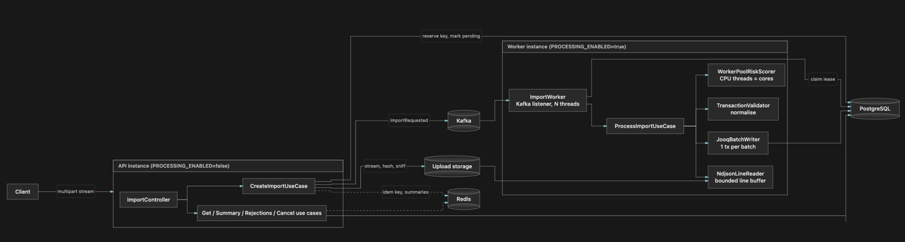
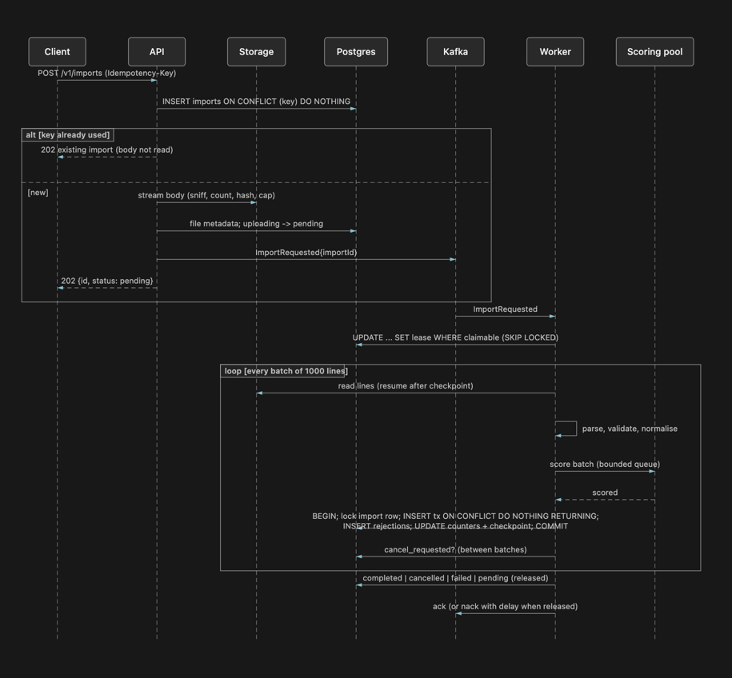

# Architecture

## Components



### Module boundaries and dependency direction

```
api  ──►  application  ──►  domain
infrastructure  ──►  application, domain
config (composition root)  ──►  everything
```

- `domain`: pure rules. `TransactionValidator`, `FingerprintCalculator`,
  `RiskScoreCalculator`, `ImportStatus` transitions, the error model. No framework imports.
- `application`: use cases and ports. `CreateImportUseCase`, `ProcessImportUseCase`,
  `CancelImportUseCase`, `GetImportSummaryUseCase`, `ListRejectionsUseCase`; ports
  `ImportRepository`, `BatchWriter`, `FileStorage`, `ImportJobQueue`, `RiskScorer`,
  `RetryPolicy`, `Clock`, `IdGenerator`, `MetricsRecorder`, `SummaryCache`,
  `IdempotencyCache`. Use cases receive every dependency through the constructor and can
  run with in-memory fakes.
- `infrastructure`: adapters. jOOQ repositories, local file storage, Kafka queue, Redis
  caches, the scoring thread pool, retry policy and failure classifier, Micrometer.
- `api`: controllers, DTOs, error mapping, request-id filter, streaming multipart reader.
- `config`: `ApplicationAssembly`, `PersistenceConfig`, `MessagingConfig`, `CacheConfig`,
  `ProcessingConfig`, `ObservabilityConfig`. The only place that instantiates adapters.

**Dependency injection** is constructor injection throughout. There is no service
locator, no static registry and no `@Autowired` field; Spring's container is used only
in `config` to assemble the graph. Database clients appear only in
`infrastructure.persistence`.

**Logging is the one deliberate exception.** Classes get their logger from a
`private static final Logger` (SLF4J) rather than through the constructor. SLF4J is
already an abstraction: code depends only on the `org.slf4j` API, and the backend
(Logback, with the JSON encoder under the `json` profile) is chosen by configuration,
not by the code. Injecting a logger into every constructor would add a parameter to
every class without making anything easier to replace. Tests can capture logs through
the backend. Per-request and per-import context (`requestId`, `importId`, `workerId`,
`batch`, ...) travels in the MDC instead of logger instances. Metrics are different:
use cases emit them through the injected `MetricsRecorder` port, so they stay free of
Micrometer and tests can assert on what was recorded (`RecordingMetrics`).

## Import status lifecycle

| From | To | When |
|---|---|---|
| `uploading` | `pending` | file stored completely, import enqueued |
| `uploading` | `failed` | empty, too large, wrong type, interrupted, or stale (reaper) |
| `pending` | `processing` | a worker claims it |
| `pending` | `cancelled` | cancel before any worker claims it |
| `pending` | `failed` | allowed by `ImportStatus`; no repository method performs it today (attempts are counted and failed from `processing`) |
| `processing` | `completed` | every line processed |
| `processing` | `cancelling` | cancel requested while a worker holds it |
| `processing` | `cancelled` | the worker observed the cancel and finalised |
| `processing` | `pending` | released: shutdown or a transient failure, resumed later from the checkpoint |
| `processing` | `failed` | permanent failure or attempts exhausted |
| `cancelling` | `cancelled` | the worker (or the next claimer of an expired lease) finalises |
| `cancelling` | `failed` | failure while winding down |
| `failed` | `pending` | only through an explicit client retry (`POST .../retry`), never automatically |

`completed`, `failed` and `cancelled` are terminal: nothing moves them on its own. The one
way out of `failed` is a client request, and it is bounded (see [Manual retry](#manual-retry)).

The assignment lists `pending`, `processing`, `completed`, `failed`, `cancelling` and
`cancelled`. The service adds **`uploading`**: the idempotency key is reserved and the
body is streaming to storage, but the file is not complete yet. It is needed because the
key is reserved *before* the body is read. That is what makes concurrent requests with the
same key converge on one import without reading the body twice. Between the reservation
and the end of the stream the row exists but has no file, so a worker must not claim it.
Calling that state `pending` would let a worker claim an import whose file isn't fully
written. With a separate state, neither the claim query nor the claimable partial index
(`pending`, `processing`, `cancelling`) ever sees it. If the API dies mid-upload, the reaper turns rows stuck in
`uploading` into `failed / UPLOAD_INTERRUPTED`, and the same key can be retried.
Clients normally never observe `uploading`: the 202 response is sent after the upload,
when the import is already `pending`. They see it only as the status a concurrent
duplicate request may return while the first request is still streaming. Allowed
transitions are enforced in `ImportStatus` (tested in `ImportStatusTest`) and by the
conditional `UPDATE ... WHERE status = ...` in every repository method.

## Processing workflow



### Step by step

1. **Upload** (`CreateImportUseCase`). Header validation, upload slot (429 if none),
   idempotency reservation, then the body is streamed through a sniffer (first bytes must
   be `{` after optional BOM; gzip/zip/PDF/NUL are refused) and a counting SHA-256 stream
   that throws at the byte limit. Storage writes `<key>.part` and renames atomically.
   Only then is the row marked `pending` and the event published.
2. **Dispatch** (`KafkaImportJobQueue`, `ImportWorker`). Each worker instance runs
   `maxConcurrentImports` consumer threads with `max.poll.records=1`. An event triggers a
   conditional claim; the claim, not the message, decides ownership.
3. **Read** (`NdjsonLineReader`). 64 KiB chunks, lines split on `\n`, physical line
   numbers, `\r\n`, BOM and a last line without newline handled, over-long lines flagged
   and discarded. Lines up to the checkpoint are skipped without parsing.
4. **Parse + validate + normalise** (`RecordParser`, `TransactionValidator`). Strict
   JSON (no NaN, no comments, bounded nesting), then the rules below.
5. **Score** (`WorkerPoolRiskScorer`). Batches are split into 100-record chunks on a
   fixed pool of `cores` platform threads with a bounded queue; a full queue blocks the
   submitting thread (back-pressure), never the API.
6. **Persist** (`JooqBatchWriter`). One transaction per batch (see consistency below).
7. **Finish**. Terminal transitions are conditional on the lease; the Kafka offset is
   acknowledged only after that.

### Normalisation rules

| Field | Rule |
|---|---|
| all strings | trimmed; control characters rejected in identifiers, replaced by spaces in the description |
| `transactionId`, `accountId`, `merchantId` | 1–128 chars after trimming |
| `amount` | JSON number, > 0, ≤ 4 decimals, < 10^15; stored with scale 4 |
| `currency` | trimmed, upper-cased, must be an ISO 4217 code (`usd` → `USD` accepted; see below) |
| `timestamp` | ISO-8601 with explicit offset or `Z`; converted to UTC, truncated to ms |
| `description` | optional; whitespace-collapsed; ≤ 500 chars; empty → null |
| unknown fields | ignored |
| blank lines | skipped, not counted |

**Why lower-case currencies are accepted.** The assignment specifies a "three-letter
uppercase currency code" and also asks the service to "normalize currency codes". The
service reads "uppercase" as the *stored, canonical* form rather than as an input rule:
`usd` and ` USD ` are both stored as `USD`. Case says nothing about which currency is
meant, and the rule that protects correctness is still strict. After trimming and
upper-casing, the value must be exactly three letters and a real ISO 4217 code
(`java.util.Currency`), so `US`, `USDX`, `XYZ` and `$` are rejected with
`INVALID_CURRENCY`. Rejecting `usd` would throw away a valid transaction from a
provider's export without making the data any safer. If a stricter contract is required,
it is a one-line change in `TransactionValidator`: compare before upper-casing. The
fingerprint is computed from the canonical form, so `usd` and `USD` produce the same
fingerprint.

### Fingerprint

`SHA-256("1" NUL provider NUL transactionId NUL accountId NUL merchantId NUL amount(scale 4) NUL currency NUL timestamp(UTC ms) NUL description)`.
Version `1` is both the first hashed field and a column, so a v2 can coexist and
comparisons are only made within a version.

### Risk score

Five bounded, deterministic components summed and capped at 100 (amount log-scaled up to
35; UTC hour up to 20; description up to 15; merchant hash bucket up to 15; iterated
SHA-256 over the fingerprint up to 15). The last component iterates the hash
`RISK_HASH_ITERATIONS` times and is the deliberately CPU-expensive step. Bands:
0–39 low, 40–69 medium, 70–100 high.

## Database as the correctness model

- **Idempotent creation**: `imports.idempotency_key UNIQUE`. The reservation is an
  `INSERT ... ON CONFLICT DO NOTHING RETURNING`; concurrent requests converge on one row.
  A key whose earlier attempt never stored a complete file may be reused.
- **Duplicate detection**: `transactions (provider_id, transaction_id) UNIQUE`. The batch
  insert uses `ON CONFLICT DO NOTHING RETURNING line_number`; rows not returned are
  duplicates, whether within the batch, the file, an earlier import, another worker or a
  previous process. Same id with different content: first accepted record wins; the later
  one is recorded as `DUPLICATE_TRANSACTION_CONFLICT` (identical content:
  `DUPLICATE_TRANSACTION`). Both count under `duplicates`, not `rejected`.
- **Atomic batches**: transactions, rejections, counters and `last_line_committed` are
  written in one transaction after locking the import row (`FOR UPDATE`) and checking the
  lease. A crash between any two statements loses the whole batch, which is re-read from
  the checkpoint on the next attempt. A batch that already committed (checkpoint ≥ batch
  end) is a no-op, so a retry after a lost commit acknowledgement cannot double count.
- **Job ownership**: `lease_owner` + `lease_expires_at`, renewed by a heartbeat every 10 s
  with a 30 s lease. Claims are `UPDATE ... WHERE id = (SELECT ... FOR UPDATE SKIP LOCKED)`
  and every state transition is a conditional update on owner and status.
- **Indexes**: partial index on claimable statuses (worker scans stay tiny), `(import_id)`
  on transactions (summaries), `(import_id, id)` on rejections (keyset pagination),
  `UNIQUE (import_id, line_number)` on rejections (re-delivery safe).
- **Delivery guarantee**: effectively-once. Kafka is at-least-once; the database makes
  duplicates harmless (claims are conditional, inserts are idempotent, batches are
  checkpointed).

## Failure recovery

| Event | Effect |
|---|---|
| API dies during upload | row stays `uploading`; reaper marks it `failed/UPLOAD_INTERRUPTED` after 15 min; client may retry with the same key |
| Broker unavailable at publish | row is `pending`; API answers 503 `QUEUE_UNAVAILABLE`; the worker's sweep re-publishes pending rows every 60 s |
| Worker dies mid-import | lease expires (30 s); the uncommitted Kafka offset is redelivered after rebalance and the sweep re-publishes expired leases; the next claim resumes from the checkpoint |
| Database connection lost | batch write retried with backoff (5 attempts, 200 ms → 5 s, ±25 % jitter); then the import is released for another attempt (3 attempts total) or failed (see [retry strategy](#retry-strategy)) |
| Same event delivered twice | second claim fails (live lease or terminal status) and is acknowledged |
| Unreadable record on the topic (not JSON, or no import id) | not retried; published to `imports.requested.DLT` with the exception headers, counted in `kafka_dead_letter_records_total{reason}`, offset committed; a real import whose event was lost this way is re-published by the sweep from its `pending` row |
| Batch committed, progress update "fails" | impossible by construction: they are the same transaction |
| Cancel during processing | `cancel_requested` observed between batches; in-flight batches commit; status `cancelled`; nothing after the checkpoint is written |
| SIGTERM | readiness DOWN, consumer paused, HTTP drains, active imports get `SHUTDOWN`, finish in-flight batches, release the job; grace period 30 s, then forced release (see [grace-period expiry](#graceful-shutdown-and-grace-period-expiry)); next worker resumes |

Cancellation vs shutdown: cancel ends the import permanently (`cancelled`, partial
results kept and queryable); shutdown releases it (`pending`) so it continues elsewhere.

## Retry strategy

Retries happen at three levels, each one for a different failure lifetime. A lower level
gives up before the level above it takes over.

| Level | Where | Handles | Budget | Then |
|---|---|---|---|---|
| 1. Operation | `ExponentialBackoffRetryPolicy` around each batch write | a failure lasting seconds: dropped connection, deadlock, serialisation failure, pool timeout, Postgres restarting | `RETRY_MAX_ATTEMPTS` = 5 attempts over about 3 s by default | the exception reaches the use case |
| 2. Import attempt | `ProcessImportUseCase.handleFailure` | a failure lasting minutes: the database is down for longer than level 1 waits | `PROCESSING_MAX_ATTEMPTS` = 3 claims of the import | the import is `failed` with `PROCESSING_FAILED` |
| 3. Dispatch | Kafka `nack(KAFKA_REDELIVERY_DELAY)` and the worker's 60 s sweep | lost events, dead workers, a broker outage at publish time | unbounded (it only re-publishes; level 2 caps the work) | — |

**Backoff.** `delay(n) = min(RETRY_MAX_BACKOFF, RETRY_INITIAL_BACKOFF × 2^(n-1)) × U[0.75, 1.25)`.
With the defaults the delays are 200, 400, 800 and 1600 ms (±25 %), a little over 3 s
in total. The jitter is there so that when one database hiccup hits several workers,
their retries spread out instead of landing together.

**What is transient** (`SqlStateFailureClassifier`, which walks the cause chain):
SQLSTATE class `08` (connection), `40001` (serialisation failure), `40P01` (deadlock),
`55P03` (lock not available), `57P01`–`57P03` (admin or crash shutdown, cannot connect
now), `57014` (statement timeout), class `53` (insufficient resources), Spring's
transient and recoverable `DataAccessException` types, `CannotGetJdbcConnectionException`,
`TransactionSystemException`, I/O errors, and `AppException`s marked retryable
(`STORAGE_FAILURE`, `DATABASE_UNAVAILABLE`).

**What is never retried:** constraint violations (class `23`), validation and business
errors, `LeaseLostException` (another worker owns the import, so retrying would fight
it), cancellation, interruption and programming errors. These fail on the first try,
because retrying cannot succeed and only hides the real failure.

**Why a retried batch is safe.** The batch transaction re-checks the lease and the
checkpoint under `SELECT … FOR UPDATE`. If the commit went through but its
acknowledgement was lost, the retry sees `last_line_committed ≥ batch end` and does
nothing (`alreadyCommitted = true`). If the commit did not happen, nothing from the batch
is visible and the retry writes it all. Either way each record is counted once.

**Cancellation and shutdown stop retries.** The policy checks the cancellation token
before each sleep. A worker that is shutting down does not wait out the backoff; it
releases the import so another worker can pick it up.

**Signals.** `retries_total{operation}` counts retry attempts and
`retries_exhausted_total{operation}` counts sequences that ran out. Each retry is logged
at WARN with `importId`, `batch` and `attempt`. A level-2 release is logged as
`Transient failure on attempt n/3`.

**Not retried by the server: uploads.** A failed upload is the client's to retry. The
`Idempotency-Key` makes that safe: a key whose upload never stored a complete file
(interrupted, too large, wrong type, empty) is re-opened, and a key whose file was
stored returns the original import.

## Graceful shutdown and grace-period expiry

On SIGTERM, in order:

1. `ContextClosedEvent` triggers `ImportWorker.signalShutdown()`. Readiness goes DOWN,
   the Kafka container is paused so no new records are fetched, and every active import's
   token is set to `SHUTDOWN`.
2. Each pipeline stops reading at its next line. Batches already handed to the writer
   (at most `PROCESSING_MAX_IN_FLIGHT_BATCHES`) commit normally. The import is then
   **released** (`processing → pending`, lease cleared) and its Kafka offset is left
   uncommitted.
3. `ImportWorker.stop()` waits up to `SHUTDOWN_GRACE_PERIOD` (30 s) for the active count
   to reach zero. Normally this takes one batch time, well under a second.

**If the grace period expires** with imports still active (for example, a batch stuck in
level-1 retries against a database that is down), the worker **force-releases** every
remaining import with the same conditional `release` (owner = this worker, status =
`processing`), stops the heartbeat and exits. Anything still running on that JVM is then
harmless:

- a batch transaction that already holds the import row lock finishes first, because
  `release` waits for the lock. The batch and its checkpoint are therefore either
  committed together or not at all;
- a batch that starts after the release fails the lease check under the row lock, so it
  throws `LeaseLostException` and writes nothing;
- the uncommitted offset is redelivered to another consumer after the rebalance, and the
  sweep re-publishes `pending` rows within `PROCESSING_REDISPATCH_INTERVAL` (60 s) if not.
  The next claim resumes from `last_line_committed`.

An import in `cancelling` is not released, since `release` only applies to `processing`.
Its lease runs out (30 s) and the next worker to claim it marks it `cancelled`.

If the container runtime kills the process before step 3 finishes (`stop_grace_period`
is shorter than the HTTP drain plus `SHUTDOWN_GRACE_PERIOD`), nothing is released and
recovery takes the crash path: the lease expires after 30 s and the import is
re-dispatched. The compose files set `stop_grace_period` to 45–60 s, above the 30 s
grace period, so the forced release normally gets to run.

## Summaries and the aggregation trade-off

The summary (totals, by currency, by risk level, top merchants and accounts) can be
produced three ways. The service uses the second and third (ADR-005):

| Approach | Write cost | Read cost | Consistency | Chosen |
|---|---|---|---|---|
| Incremental aggregates updated in every batch transaction | one upsert per distinct currency, risk level, merchant and account per batch, on rows every batch contends for | one small read | exact, but the hot path pays for it | no |
| Derived on read: `GROUP BY` over `transactions WHERE import_id = ?` | none | a scan of the import's rows through the `(import_id)` index | exact: it reads what has been committed | while the import runs |
| Materialised once: computed at the first read after the import is terminal, stored in `import_summaries` (JSONB) | one row, once | one primary-key read | exact; the import can no longer change | once terminal |

On top of that, Redis caches the summary for 2 s while the import is live and 1 h once
it is final. A cached live summary is only used if its totals equal the import's current
`processed` counter, so polling never shows progress going backwards.

**Why derive instead of maintaining incrementally.** Ingest throughput is the constraint
that matters. Incremental aggregates would add up to (currencies + 3 + merchants +
accounts) upserts to every batch transaction, all contending on the same aggregate rows,
and would need their own idempotency so a retried batch is not counted twice. Deriving
from `transactions` is correct by construction, because the summary and the progress
counters come from the same committed rows.

**What it costs.** A live summary of a large running import is an index scan plus four
aggregations over that import's committed rows, so its cost grows with the import. The 2 s cache caps it at one
scan per import every 2 s no matter how many clients poll, and status polling
(`GET /v1/imports/{id}`) reads the counters on the import row instead, so it never pays
for a scan. Once the import is terminal, a read costs one row lookup.

**Bounded output.** Merchants and accounts are capped at the top 100 by count, so the
response size and the sort stay bounded for a file with 500k distinct accounts. A full
breakdown would need its own paginated endpoint.

**When to revisit.** If dashboards need live summaries of many large imports at once,
the next step is a per-batch partial aggregate written into the batch transaction (one
row per batch, idempotent through the batch number) and summed on read. That is cheaper
than a per-group upsert and keeps the same once-only guarantee.

## Back-pressure and bounded concurrency

| Resource | Bound | What happens at the limit |
|---|---|---|
| concurrent uploads | `UPLOAD_MAX_CONCURRENT` (4) | 429 immediately |
| imports per worker | `PROCESSING_MAX_CONCURRENT_IMPORTS` (2) consumer threads | events wait in Kafka; `import_queue_depth` grows |
| total imports in flight | Kafka partitions (8) | more consumers than partitions idle |
| batches in memory per import | `PROCESSING_MAX_IN_FLIGHT_BATCHES` (2) × batch size (1000) | the reader blocks on a semaphore |
| scoring | `cores` threads, queue `RISK_QUEUE_CAPACITY` (4000 chunks) | submitting thread blocks |
| database connections | `DB_POOL_SIZE` (10) | callers wait up to 5 s, then a transient error → retry |
| HTTP | Tomcat max threads 200, virtual threads for handlers | connections queue at the accept level |
| line length / file size | 16 KiB / 200 MB | rejected without buffering |

Nothing creates a task per record: the only futures are the per-batch scoring futures,
already bounded by the in-flight permit.

## Observability

Structured logs (JSON with the `json` profile) carry `requestId`, `importId`, `workerId`,
`batch`, `attempt`, `errorCode`, `shutdown`. Uploaded content and descriptions are never
logged. Metrics are listed in the README with the thresholds that indicate a problem.
Health: `/health/live` (process only) and `/health/ready` (database, storage, Kafka,
worker state); Redis is reported but does not gate readiness because the caches fail soft.

## Security

Size and line limits, content sniffing instead of trusting MIME type or filename,
sanitised filenames stored only as metadata, server-generated storage keys (no path
input), strict JSON parsing, control-character rejection, bounded raw excerpts in
rejections, parameterised SQL via jOOQ, request ids instead of stack traces in
responses, low-cardinality metric tags. Authentication is an opt-in servlet filter that
resolves an API key to a provider id; the use cases are unchanged (see
[Authentication](#authentication-opt-in)).

## Optional features

Each of these adds behaviour around the core without changing its guarantees. All the
optional ones are off by default.

### Manual retry

`POST /v1/imports/{id}/retry` moves a `failed` import back to `pending` with one
conditional update (`RetryImportUseCase` → `ImportRepository.retryFailed`). The update
requires all of the following:
- status `failed`;
- the file was stored completely (`storage_key IS NOT NULL`);
- the file has not been purged (`file_purged_at IS NULL`);
- `retry_count < PROCESSING_MAX_MANUAL_RETRIES`.

- **Resumes, does not restart.** Counters, `last_line_committed`, accepted transactions and
  rejections stay. The next claim reads from the checkpoint, and the unique constraint plus
  the checkpoint guard make double counting impossible, exactly as after a crash.
- **Fresh but bounded attempt budget.** `attempt_count` keeps increasing, so
  `import_attempts` history is never rewritten. The retry sets
  `attempt_base = attempt_count`, and the automatic budget applies to
  `attempt_count - attempt_base`. Manual retries are capped separately, so a client cannot
  create unbounded work.
- **Failed uploads are excluded.** A failed upload has no file. The client re-uploads with
  the same `Idempotency-Key`, which re-opens the row (already supported).
- **Idempotent.** A second retry while the import is re-queued returns its current state.
  Concurrent retries apply once (tested in `JooqRetryAndRetentionIT`).
- **Summaries stay correct.** The failed import's summary was final and materialised. A
  stored or cached summary is now used only if its totals equal the import's `processed`
  counter, and `saveFinal` upserts. So the pre-retry summary is recomputed rather than
  served once the import finishes again, even if a reader raced the retry.
- **Dispatch** is the normal path: the event is published best-effort, and the sweep
  re-publishes `pending` rows if it is lost.

### Dead-letter topic

A record the worker cannot use at all goes to `imports.requested.DLT` (same partition as
the original) through Spring Kafka's `DeadLetterPublishingRecoverer`:
- bytes that are not an `ImportRequestedEvent`, stored as the original bytes;
- an event without an import id, stored as the re-serialised parsed event.

Each record carries the exception class, message, stack trace and the original
topic/partition/offset as headers. Such records are never retried, because they cannot
succeed. The recovered offset is committed so the partition keeps moving.

The DLT is for inspection, not replay. The database is the source of truth, and a real
`pending` import is re-published by the sweep whatever happened to its event.

### Progress streaming (server-sent events)

`GET /v1/imports/{id}/events` streams the same body as `GET /v1/imports/{id}`. It polls the
database, one read per watched import per `EVENTS_POLL_INTERVAL`, shared by every client
watching that import. There is no push from the worker. The API and the worker are
separate processes, and the committed counters are the only progress that is guaranteed to
be true. A push channel would need a broker fan-out and could show batches that were later
rolled back. Polling also bounds database load by the number of *distinct* imports being
watched, not by the number of clients.

The limits:
- an event is sent only when something changed, with a comment heartbeat every 15 s;
- `EVENTS_MAX_CONNECTIONS` streams per instance, after which clients get 429 with `Retry-After`;
- streams close at a terminal status, after `EVENTS_TIMEOUT` (the client reconnects), and as
  soon as shutdown starts, so open streams never hold up the HTTP drain.

Caddy's compression is disabled for this path, because a compressing encoder would buffer
events.

### Per-provider rate limits

When `UPLOAD_PROVIDER_RATE_LIMIT > 0`, `CreateImportUseCase` asks the `UploadRateLimiter`
port before taking an upload slot or reserving a row. The Redis adapter keeps a
fixed-window counter per provider, `rl:upload:<provider>:<window>`. One Lua script does
`INCR` and sets the expiry on first use, so a counter can never be left without a TTL.

Over the limit, the request gets 429 `PROVIDER_RATE_LIMITED` with `Retry-After` set to the
seconds left in the window. Fixed windows can admit up to twice the limit across a window
boundary. That is accepted for fairness between providers, and it keeps the check to one
round trip.

The limiter fails open, consistent with ADR-007. When Redis is down, uploads are admitted
and the per-instance concurrency and size limits still apply.

This limit and `UPLOAD_MAX_CONCURRENT` answer different questions:
- the rate limit decides whether this provider is getting too much of the service, across
  all instances;
- `UPLOAD_MAX_CONCURRENT` decides whether this instance can stream another body right now.

### Authentication (opt-in)

With `API_KEYS_ENABLED=true`, `ApiKeyAuthenticationFilter` protects `/v1/**`. It runs right
after the request-id filter, so a rejection still carries a request id.
- **Keys and hashes.** Clients send `Authorization: Bearer <key>` or `X-API-Key`. The server
  knows only SHA-256 hashes, each mapped to a provider id. A leaked config leaks no usable
  keys, and the config is validated at startup.
- **Provider.** The key's provider becomes the import's provider. An `X-Provider-Id` that
  contradicts it gets 403.
- **Ownership.** Every read and action checks it. Another provider's import answers 404, not
  403, so ids cannot be probed for existence.
- **Open endpoints.** Probes, `/metrics` and the API docs stay open. They carry no import
  data, and probes and scrapers do not send credentials.

It is off by default so that the public evaluation deployment stays callable. The use cases
did not change: they already took the provider as a parameter, which was the extension
point. JWT/OIDC would replace the key lookup in the same filter.

### Data retention

With `RETENTION_ENABLED=true`, each worker runs `PurgeExpiredUploadsUseCase` every
`RETENTION_INTERVAL`. Each run takes at most `RETENTION_BATCH_SIZE` imports, oldest first,
from imports that have been terminal for longer than `RETENTION_UPLOADED_FILES_AFTER` and
still have their file. A partial index (`imports_retention_idx`) keeps that scan small.

Only the uploaded file is deleted. The import, its counters, transactions, rejections and
summary are the reconciliation result and stay queryable.

Per import the order is mark, then delete:
- `markFilePurged` is conditional on a terminal status and `file_purged_at IS NULL`, so it is
  mutually exclusive with a retry (tested by racing the two 20 times);
- with several workers, each import is purged exactly once;
- a crash between the mark and the delete leaves an orphaned file whose row already says
  purged. Nothing reads it; the key is logged for cleanup.

Rows are not deleted. That would change the meaning of a finished import's totals, and the
rows are small compared with the files.

### Tracing (OpenTelemetry)

Micrometer Observation is bridged to OpenTelemetry. It is always on in-process, so
`traceId` and `spanId` appear in every JSON log line. Spans are exported over OTLP only
when `MANAGEMENT_OTLP_TRACING_ENDPOINT` is set (`docker-compose.tracing.yml` adds Jaeger).

One upload produces one trace:
- `http post /v1/imports` → `imports.requested send`;
- W3C headers on the Kafka record → `imports.requested receive` in the worker;
- one `import batch write` span per batch.

The batch writer runs on a thread the use case creates, so the trace is carried there by an
injected `ThreadFactory` that captures the context (Micrometer context-propagation) on the
claiming thread. The batch spans come from an `ObservedBatchWriter` decorator. Neither
touches the use case's code.

The import id and batch number are span attributes only, never metric tags. This was
verified end to end in Jaeger: the batch-write spans are children of the consumer span,
which is a child of the producer span, which is a child of the HTTP request.

### Kubernetes

`deploy/k8s` (kustomize) runs the API and worker as separate Deployments:
- startup, liveness and readiness probes on the existing endpoints;
- a `preStop` delay and a 60 s termination grace covering `SHUTDOWN_GRACE_PERIOD`;
- the scoring pool sized explicitly to the worker's CPU request;
- non-root, read-only root filesystem;
- a `ReadWriteMany` volume for uploads, which is the limit of the local-storage adapter
  (ADR-004).

Postgres, Kafka and Redis are expected as managed services or operators. The manifests pass
`kubeconform -strict` for Kubernetes 1.30.

